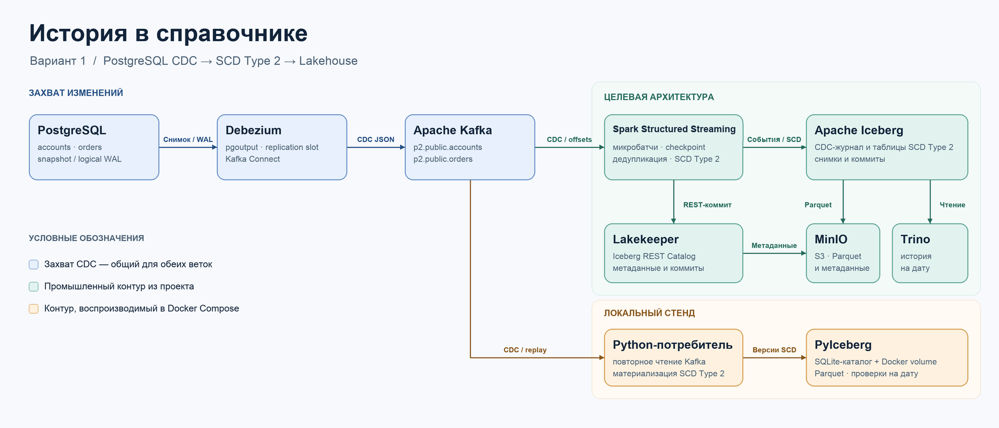

# Отчёт по практической работе №2

## 1. Вариант и задача

| Поле | Значение |
| --- | --- |
| ФИО (как в VK Education) | Рыжков Леонид Сергеевич |
| Тема | Вариант 1. История в справочнике (CDC → SCD → Lakehouse) |
| Состав решения | PostgreSQL → Debezium → Kafka → Spark Structured Streaming → Iceberg с каталогом Lakekeeper и хранилищем MinIO → Trino. В локальном стенде историю из Kafka строит Python-потребитель и пишет в Iceberg через PyIceberg. |
| Данные, объём | Учебный набор из двух таблиц. Две исходные строки, семь последующих изменений и одно служебное сообщение Kafka при удалении. Семь строк истории в двух таблицах SCD Type 2. |

Бухгалтерии нужно узнать, кто был владельцем счёта на 1 марта, а аналитикам — какой статус был у заказа непосредственно перед отменой. PostgreSQL обслуживает операционные записи. Запросы по истории идут в Lakehouse, от источника нужны первоначальный снимок выбранных таблиц и чтение логического WAL.

## 2. Источники и способы сбора

| Источник | Тип | Способ сбора и обоснование |
| --- | --- | --- |
| PostgreSQL, `public.accounts` | Начальный снимок + CDC | Debezium читает текущие строки при первом запуске, затем получает изменения через `pgoutput`. Ключ `id`, отслеживаемый атрибут `owner_name`. |
| PostgreSQL, `public.orders` | Начальный снимок + CDC | Тот же коннектор и слот захватывают создание, изменение и удаление заказов. Ключ `id`, отслеживаемый атрибут `status`. |
| Kafka, по топику на таблицу | Поток CDC, промежуточный источник | Kafka хранит сообщения для повторного чтения. Ключ сообщения формируется из первичного ключа PostgreSQL, поэтому сообщения объекта остаются в одной партиции при фиксированном числе партиций. |

В PostgreSQL включён `wal_level=logical`, публикация содержит две нужные таблицы. Роль `cdc` читает их для снимка и имеет право репликации. `REPLICA IDENTITY FULL` сохраняет образ строки до изменений для демонстрации, в том числе для DELETE. Цена такого выбора — дополнительный объём WAL. На большой таблице первоначальный снимок планируется на период низкой нагрузки, а отставание слота контролируется, поскольку он удерживает нужный коннектору WAL. [Документация Debezium по PostgreSQL](https://debezium.io/documentation/reference/3.3/connectors/postgresql.html).

## 3. Архитектура



[Редактируемая схема draw.io](architecture.drawio)

Голубые блоки показывают общий захват изменений, зелёные — целевой Lakehouse, оранжевые — локальную проверку. В целевой схеме Lakekeeper хранит регистрацию таблиц и координирует Iceberg-коммиты через REST API. MinIO хранит Parquet и файлы метаданных. Trino получает расположение таблиц через каталог и читает их файлы из MinIO. [Интеграция Lakekeeper с движками](https://docs.lakekeeper.io/docs/latest/engines/), [Iceberg в Trino](https://trino.io/docs/current/connector/iceberg.html), [совместимые S3-хранилища](https://trino.io/docs/current/object-storage/file-system-s3.html).

### Выбор типа SCD

| Тип | Когда подходит | Решение для этой задачи |
| --- | --- | --- |
| Type 1 | Исправление опечатки или справочник, где нужен только текущий атрибут | При перезаписи пропадает прежний владелец или статус. |
| Type 2 | Нужны все версии и запросы на произвольный момент | Каждая версия хранится отдельной строкой с интервалом действия. Выбран для обоих справочников. |
| Type 6 (гибрид 1, 2 и 3) | Вместе с историческим значением в каждой версии часто нужен и текущий атрибут | Дублирование текущего значения потребовало бы обновлять прошлые строки. Для этой задачи текущую версию можно получить по `is_current`. |

### Выбор обработки

Для целевого потока выбран Spark Structured Streaming с микробатчами, например каждые 30 секунд. В пределах порции можно убрать повторы, пересчитать версии по изменившимся ключам и одним коммитом обновить каждую таблицу. Такой интервал подходит для аналитики с запросами на дату. Непрерывная обработка уместна при требовании к задержке в доли секунды. Режим Continuous Processing в Spark не поддерживает `foreachBatch`, который нужен для выбранной схемы записи. [Документация Spark Structured Streaming](https://spark.apache.org/docs/3.5.7/structured-streaming-programming-guide.html#using-foreach-and-foreachbatch).

В целевой схеме Spark держит входные позиции в устойчивом checkpoint. Он сохраняет записи CDC в отдельной Iceberg-таблице с идентификатором события, затем пересчитывает затронутые ключи из этого журнала. При `MERGE INTO` версии сопоставляются по `(id, valid_from)`. В порцию входят вставки, изменения и удаления версий, которые исчезли при пересчёте. Повтор микробатча применяет те же изменения. Коммиты атомарны в рамках одной таблицы, поэтому при сбое между записями журнал остаётся источником для повторного расчёта. Локальный стенд читает небольшой Kafka-журнал с начала и коммитит пересчитанные таблицы через PyIceberg. [API записи и чтения PyIceberg](https://py.iceberg.apache.org/api/).

## 4. Docker — что поднялось

| Блок | Статус |
| --- | --- |
| PostgreSQL | Запущен в Docker, `wal_level=logical`. |
| Apache Kafka | Запущен в Docker в режиме KRaft. |
| Debezium / Kafka Connect | Запущен в Docker. Контейнер `lab` настраивает коннектор через REST. |
| Python и PyIceberg | Одноразовый контейнер `lab` читает реальные события из Kafka, строит таблицы и проверяет результат по данным из Iceberg. |
| Spark, Lakekeeper, MinIO и Trino | Спроектированы для целевого контура. Для локального опыта использованы Python, SQLite-каталог Iceberg и том Docker, поэтому проверка CDC и SCD Type 2 требует только трёх постоянных сервисов. |

Из каталога работы выполняются команды

```bash
docker compose up -d
docker compose run --build --rm lab
docker ps --filter label=com.docker.compose.project=p2-cdc-scd --format 'table {{.Names}}\t{{.Image}}\t{{.Status}}'
```

При первом старте Kafka завершилась с ошибкой доступа к каталогу KRaft. После переноса тома в `/var/lib/kafka/data`, доступный пользователю образа, Kafka запустилась и прошла healthcheck. PostgreSQL, Kafka и Iceberg используют именованные тома. Контейнер `lab` завершает работу после проверок.

### Вывод `docker ps` после прогона

```text
NAMES                   IMAGE                                  STATUS
p2-cdc-scd-connect-1    quay.io/debezium/connect:3.3.1.Final   Up 56 seconds
p2-cdc-scd-postgres-1   postgres:16.10-alpine                  Up About a minute (healthy)
p2-cdc-scd-kafka-1      apache/kafka:4.0.2                     Up About a minute (healthy)
```

### Вывод `lab`

```text
Debezium p2-postgres: RUNNING, task RUNNING
Kafka p2.public.orders p0:0 op=r id=7001 CREATED
Kafka p2.public.accounts p0:0 op=r id=101 Анна Орлова
Kafka p2.public.orders p0:1 op=u id=7001 PAID
Kafka p2.public.orders p0:2 op=u id=7001 CANCELLED
Kafka p2.public.orders p0:3 op=c id=7002 CREATED
Kafka p2.public.orders p0:4 op=d id=7002 CREATED
Kafka p2.public.orders p0:5 tombstone
Kafka p2.public.accounts p0:1 op=u id=101 Борис Иванов
Kafka p2.public.accounts p0:2 op=u id=101 Борис Иванов
Kafka p2.public.accounts p0:3 op=u id=101 Вера Смирнова
Iceberg history.accounts_scd2: snapshot=7519562629036729383
Iceberg history.orders_scd2: snapshot=6733818837919982689

accounts: id | owner_name | valid_from (UTC) | valid_to (UTC) | is_current
101 | Анна Орлова | 2026-02-24 08:00:00+00:00 | 2026-03-04 10:00:00+00:00 | False
101 | Борис Иванов | 2026-03-04 10:00:00+00:00 | 2026-03-08 10:00:00+00:00 | False
101 | Вера Смирнова | 2026-03-08 10:00:00+00:00 | None | True

orders: id | status | valid_from (UTC) | valid_to (UTC) | is_current
7001 | CREATED | 2026-02-26 14:00:00+00:00 | 2026-03-02 11:00:00+00:00 | False
7001 | PAID | 2026-03-02 11:00:00+00:00 | 2026-03-06 09:00:00+00:00 | False
7001 | CANCELLED | 2026-03-06 09:00:00+00:00 | None | True
7002 | CREATED | 2026-03-01 12:00:00+00:00 | 2026-11-24 18:31:24.335000+00:00 | False

На 1 марта счёт 101: Анна Орлова
Заказ 7001 до отмены: PAID; в момент отмены: CANCELLED
Проверки SCD Type 2 пройдены.
```

После повторного запуска потребитель заново прочитал те же десять сообщений Kafka. В Iceberg осталось по три версии счёта 101 и заказа 7001 и одна закрытая версия заказа 7002. Идентификаторы снимков обеих таблиц совпали с первым прогоном, то есть повторное чтение не добавило строк и не вызвало нового коммита.

## 5. Описание пути данных

| Шаг | Для чего | Результат |
| --- | --- | --- |
| 1. Снимок PostgreSQL | Зафиксировать начальные состояния | Debezium публикует записи `op=r` для счёта 101 и заказа 7001. История до известных начальных состояний в этом опыте отсутствует. |
| 2. Чтение WAL | Получать новые изменения с небольшой нагрузкой на источник | Коннектор преобразует зафиксированные INSERT, UPDATE и DELETE в события `c`, `u`, `d` с ключом и позициями источника. |
| 3. Публикация в Kafka | Отвязать потребителя от базы и дать ему возможность повторить чтение | Два топика, в каждом по одной партиции. Удаление даёт событие `d`, за которым следует tombstone с пустым значением. |
| 4. Материализация истории | Привести события к интервалам действия | Потребитель пропускает tombstone, устраняет повторы и рассчитывает интервалы по каждому ключу. |
| 5. Запись в Iceberg | Сохранить датированные версии | Таблицы `history.accounts_scd2` и `history.orders_scd2` содержат ключ, атрибут, `valid_from`, `valid_to` и `is_current`. Версия однозначно определяется парой `(id, valid_from)`. |
| 6. Чтение версии на момент | Ответить на вопросы пользователей | Версия выбирается по условию `valid_from <= t AND (valid_to IS NULL OR t < valid_to)`. |

Порядок Kafka используется для выбора последнего изменения, если у одного ключа совпало бизнес-время. Идентификатор события WAL составляют LSN, идентификатор транзакции и номер события в транзакции. Для начального снимка используется пара «таблица, ключ» в рамках одной инициализации источника. Повторное воспроизведение тех же событий не создаёт новых версий. При приходе более раннего бизнес-события шкала ключа пересчитывается заново из доступного журнала.

Все интервалы в UTC и имеют вид `[valid_from, valid_to)`. Для создания и обновления началом служит `effective_at` из строки PostgreSQL. При изменении владельца или статуса действующий интервал закрывается и открывается следующий. Обновление одного `effective_at` при том же значении атрибута не создаёт новую версию. DELETE закрывает интервал по времени источника из CDC, поскольку переданный образ строки не содержит отдельной даты удаления. Для открытой версии `valid_to IS NULL` и `is_current = true`.

### Запросы по истории

В целевом Trino таблицы были бы доступны через каталог `lakehouse`. В Docker проверяются те же условия на строках, считанных обратно из Iceberg.

```sql
SELECT owner_name
FROM lakehouse.history.accounts_scd2
WHERE id = 101
  AND valid_from <= TIMESTAMP '2026-03-01 00:00:00 UTC'
  AND (valid_to IS NULL OR valid_to > TIMESTAMP '2026-03-01 00:00:00 UTC');

SELECT status
FROM lakehouse.history.orders_scd2
WHERE id = 7001
  AND valid_from <= TIMESTAMP '2026-03-06 08:59:59.999999 UTC'
  AND (valid_to IS NULL OR valid_to > TIMESTAMP '2026-03-06 08:59:59.999999 UTC');
```

Владелец счёта 101 на 1 марта по результатам прогона — **Анна Орлова**. Заказ 7001 за микросекунду до отмены был в состоянии **PAID**, а ровно с 09:00 UTC — **CANCELLED**.

## 6. Выводы

CDC передаёт изменения из журнала PostgreSQL, поэтому аналитические запросы можно отделить от операционной базы. SCD Type 2 хранит историю прямо в строках таблицы, и запросу на дату достаточно выбрать подходящий интервал. При переносе этой схемы на рабочий поток важны контроль отставания слота, достаточный срок хранения событий для восстановления и повторяемая запись микробатчей.
